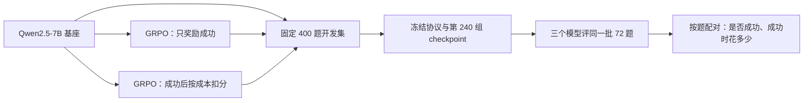

# ToolRL · Agent 能否用更低的工具成本答对？

两条路径都答对时，少一次昂贵检索值得奖励。但在训练中加入这项奖励，换一批题后还会更省吗？在 Qwen2.5-7B-Instruct 上，**开发集更省，独立盲测没有复现**。

| 模型 | 固定开发集 · 400 题 | 新模板盲测 · 72 题 |
|---|---:|---:|
| Base（未训练） | 246/400 · 61.50% | 22/72 · 30.56% |
| Success-only（只奖励成功） | 399/400 · 99.75% | 35/72 · 48.61% |
| Cost-aware（成功时再扣成本） | 400/400 · 100% | 35/72 · 48.61% |


两个训练模型在盲测答对的是**同样的 35 题**。这些题的成本从 103 升到 119；另 37 道共同失败题从 228 降到 208。全题合计少花 4 个单位，**不是成功路径更高效**。工具成本按工具价目累计，不是调用次数或 GPU 费用。[完整分组与计算口径 →](reports/toolrl-paired-results.md)

## 实验怎么做

早期环境只有只读查询；后续加入状态提交、违规检查和最终状态判分。这是环境工程。下面的奖励对照**不改环境或判分器**：两次训练各用 240 题 × 4 条采样，共用底座、任务、提示、工具预算和贪心评测设置。



成本奖励为 `S × (1 − 0.2 × clip(C / 40, 0, 1))`：失败仍为零，成功路径间才比较成本。仅一个训练种子；72 题共享六个测试世界，不是 72 次独立实验。

## 本地复现：无需 GPU 或模型下载

需 Git、Python 3.9+；以下三步只用标准库，在仓库根目录执行。私有仓库需要读取权限。

```bash
git clone https://github.com/mondeath/ToolRL.git
cd ToolRL
```

**1 · 复算图中数字。** 从[公开范围内的分组计数及成本总和](reports/paired-cost-groups.csv)计算差值；这是聚合结果复核，不是重新推理。

```bash
python3 scripts/summarize_paired_cost.py
```

预期：开发集共同成功 399 题，均差 −0.343；盲测共同成功 35 题，均差 +0.457。

**2 · 验证环境。** 检查任务与世界生成、工具成本记账、终止行为和奖励；成功时显示 `Ran 6 tests` 和 `OK`。

```bash
python3 -m unittest discover -s tests -p test_pipeline.py
```

**3 · 检查冻结的训练计划。** 两条命令分别验证 24 题 smoke 和 240 题 Success-only 配置，不加载权重、不启动训练、不写运行目录。

```bash
python3 scripts/run_grpo_v2.py --config configs/grpo_v2_gpu_smoke.json --dry-run
python3 scripts/run_grpo_v2.py --dry-run
```

预期：`status: passed`、`training_started: false`；分别为 24 组 / 96 条、240 组 / 960 条计划采样。**这不是重训或重跑盲测。** 完整三模型评测还需冻结底座、两份训练后的 adapter 和正式评测入口；当前仓库不随首页分发整套运行产物。不要用 dry-run 代替性能验证。

## 从哪里读

| 想看什么 | 入口 |
|---|---|
| 所有实验文档，按阶段查找 | [文档索引](docs/README.md) |
| 环境如何知道任务真正完成 | [环境设计](docs/environment/ENV_V1_PLAN.md) · [环境结果](docs/environment/ENV_V1_RESULTS.md) |
| 训练正确性、采样和 checkpoint | [V2 实现](docs/grpo-v2/GRPO_V2_IMPLEMENTATION.md) · [基线运行准备](docs/grpo-v2/GRPO_V2_SUCCESS_ONLY_BASELINE_PREP.md) |
| 配置、执行入口与已有运行 | [configs](configs/) · [scripts](scripts/) · [results](results/) |
